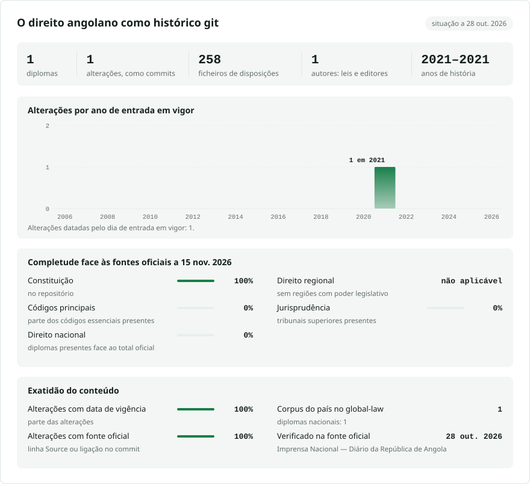

# Angola: a história do direito em git

**Português** · [English](README.en.md)

<picture>
<source media="(prefers-color-scheme: dark)" srcset="data/pt/effort-dark.svg">

</picture>

O direito de Angola como uma história git: um ficheiro por disposição, um commit por versão no dia em que entrou em vigor e, como autor do commit, o ato que fez cada alteração. `git blame` indica o ato por detrás de cada parágrafo; `git log` lista todas as alterações a um artigo; escolhendo uma data, obtém-se o texto em vigor nesse dia.

Faz parte de [lexifina/global-law](https://github.com/lexifina/global-law), uma única história git do direito de todos os países: este é o direito nacional de Angola, que o global-law lê em `angola/national/acts/`.

**O que contém por agora:** a Constituição (Constituição da República de Angola), numa só versão: a republicação oficial de 16 de agosto de 2021 ordenada pela revisão constitucional da Lei n.º 18/21, com os artigos 1.º a 244.º e os 7 aditados com uma letra (como o 107.º-A), o preâmbulo, os três anexos e a fórmula de aprovação. [`constituicao/README.md`](constituicao/README.md) lista todas as disposições.

Cada disposição é um ficheiro em `constituicao/` (`art-076.md` é o artigo 76.º, Direito ao trabalho; `art-107-a.md` é o artigo 107.º-A); as epígrafes das divisões (Título, Capítulo, Secção) estão reunidas em [`constituicao/estrutura.md`](constituicao/estrutura.md), cada uma com a indicação do artigo que a segue.

O texto está em português, tal como o Diário da República o publica. Não faz parte deste registo nenhuma tradução inglesa.

## Perguntas como comandos git

| Pergunta | Comando |
| --- | --- |
| Todas as alterações ao artigo 76.º da Constituição (direito ao trabalho) | `git log -p --word-diff -- constituicao/art-076.md` |
| Que ato escreveu cada parágrafo do artigo 76.º? | `git blame constituicao/art-076.md` |
| Todas as versões do artigo 76.º, com o dia em que cada uma entrou em vigor | `git log --format="%h %(trailers:key=In-force,valueonly,separator=) %an" -- constituicao/art-076.md` |
| O artigo 76.º em vigor em 1 de janeiro de 2022 | `python tools/vigente_em.py 2022-01-01 constituicao 76` |

**Fora do git**, também disponibilizamos este registo publicamente e de forma gratuita:

- **[Perguntar ao Claude sobre o direito angolano](https://global-law.lexifina.com/v1/try_claude?country=angola)**: abre o Claude com uma primeira pergunta já preparada.
- **[Perguntar ao ChatGPT](https://global-law.lexifina.com/v1/try_chatgpt?country=angola)**: a mesma pergunta no ChatGPT.
- **[Pesquisar o direito angolano no nosso sítio](https://lexifina.com/law?country=angola&q=f%C3%A9rias)**: uma pesquisa por "férias", com o texto de cada disposição e as suas versões, sem necessidade de conta.
- **[API REST para programadores](https://global-law.lexifina.com/v1/search_law?query=f%C3%A9rias&jurisdiction=angola)**: a mesma pesquisa em JSON, sem chave. Veja a [documentação aqui](https://lexifina.com/api/global-law).

Ambos os assistentes leem o registo através do conector gratuito Global law (MCP, `https://global-law.lexifina.com/mcp`); da primeira vez, a conversa dá-lhe a ligação que o adiciona. Pergunte em português ou em inglês.

**Aloje-o facilmente por conta própria.** Basta ter git e Python, e as ferramentas correm na sua máquina:

```sh
git clone --depth 1 https://github.com/lexifina/global-law && cd global-law
python3 tools/countries.py add angola/national/acts
python3 tools/law.py show 2026-01-01 angola/national/acts/constituicao/art-076.md
```

Aberto no Claude Code, no Cursor, no VS Code ou no Codex, o clone inicia também um servidor MCP local com as mesmas ferramentas ([MCP.md](https://github.com/lexifina/global-law/blob/main/MCP.md)).

## Datas

Cada commit tem a data do meio-dia, hora de Africa/Luanda, do dia em que a versão entrou em vigor, e indica-a no seu trailer `In-force:`:

- o dia resulta da norma de entrada em vigor da lei que fez a versão: a Lei n.º 18/21, artigo 6.º, põe a revisão em vigor na data da sua publicação, 16 de agosto de 2021;
- `tools/vigente_em.py` escolhe a versão por esse trailer, e não pela data do commit.

A única versão é atribuída ao editor, a Imprensa Nacional (Diário da República de Angola), como a versão mais antiga disponível, e o seu commit indica a Constituição de 2010 e a Lei n.º 18/21 como as leis que produziram o texto. Uma alteração posterior será atribuída à lei que a fez; o committer é sempre a Lexifina.

## Como é verificado

- `tools/check_repo.py` relê a partir do git cada versão no dia em que entrou em vigor e no dia anterior, e ambas têm de coincidir com o corpus: 0 divergências. Os resultados estão em [`REPRODUCE.md`](REPRODUCE.md).
- Todos os artigos, o preâmbulo, os anexos e a fórmula de aprovação foram comparados palavra a palavra com a *Edição Especial Actualizada* (2022) do Tribunal Constitucional. Coincidem, salvo em cinco pontos em que as duas edições diferem (artigos 36.º, 42.º, 173.º, 174.º e 242.º); mantém-se a redação do Diário da República, e o `REPRODUCE.md` enumera cada um deles.
- A história só cresce por acréscimo: sem commits de fusão (merge), sem nenhum commit com data futura, e os trailers de todos os commits são legíveis.

## O que não mostra

- **A Constituição de 2010 tal como foi publicada pela primeira vez**, e, portanto, as palavras que a Lei n.º 18/21 substituiu. O Diário da República de 5 de fevereiro de 2010 só existe como imagem digitalizada, que este registo não transcreve, e a Lei n.º 18/21 publica apenas a nova redação das disposições que altera.
- **Nenhum outro ato, por enquanto.** O Código Penal (Lei n.º 38/20) e o Código do Processo Penal (Lei n.º 39/20) estão construídos no ramo `preview`, mas retidos fora do `main`: o Código Penal foi alterado pela Lei n.º 12/24, que não foi encontrada com camada de texto, e a história posterior do Código do Processo Penal ainda não está verificada. Os textos publicados apenas como digitalizações, como a lei de proteção de dados (Lei n.º 22/11), não estão incluídos.
- **As notas de rodapé do Diário da República**, que assinalam 26 disposições como "Alterado", 7 como "Aditado" e 6 como "Revogado" pela Lei n.º 18/21, e a lista dos legisladores constituintes publicada a seguir aos anexos.

## Fontes

| Fonte | Tipo | Versões anteriores | Notas |
| --- | --- | --- | --- |
| [Governo de Angola, portal de legislação](https://governo.gov.ao/documentos/constitui%C3%A7%C3%A3o) | Jornal oficial: Diário da República, I Série (Imprensa Nacional), PDF nativamente digitais | não, o número tal como publicado | O texto e as suas datas, da I Série n.º 154, de 16 de agosto de 2021 |
| [Tribunal Constitucional](https://www.tribunalconstitucional.ao) | Edição oficial: *Constituição da República de Angola, Edição Especial Actualizada* (2022) | não | Apenas uma verificação cruzada palavra a palavra |

## Licença

Veja [`LICENSE`](LICENSE). Os textos são textos jurídicos oficiais da República de Angola, provenientes do Diário da República (Imprensa Nacional), reproduzidos com essa atribuição; o portal não publica nenhuma licença para eles. A história, as mensagens de commit, as tabelas e as ferramentas estão sob CC0 1.0.

Nenhum modelo de IA escreveu, traduziu ou corrigiu texto jurídico, e nenhum é executado quando a história é construída; os scripts foram escritos por um modelo de IA (veja [`REPRODUCE.md`](REPRODUCE.md)).

Esta é uma tradução da versão inglesa ([README.en.md](README.en.md)); em caso de divergência, prevalece a versão inglesa.

## Mais informação

Do repositório [lexifina/global-law](https://github.com/lexifina/global-law) (páginas em inglês):

- [FEATURES.md](https://github.com/lexifina/global-law/blob/main/FEATURES.md): todas as funcionalidades e o que cada corpus tem de suportar (`git blame`, `law.py`, ferramentas MCP)
- [FAQ.md](https://github.com/lexifina/global-law/blob/main/FAQ.md): perguntas e respostas · [CONTRIBUTING.md](https://github.com/lexifina/global-law/blob/main/CONTRIBUTING.md): propor alterações · [MCP.md](https://github.com/lexifina/global-law/blob/main/MCP.md): servidor MCP · [REPRODUCE.md](https://github.com/lexifina/global-law/blob/main/REPRODUCE.md): como foi construído · [CHANGELOG.md](https://github.com/lexifina/global-law/blob/main/CHANGELOG.md)
- [FRESHNESS.md](https://github.com/lexifina/global-law/blob/main/FRESHNESS.md): quão atualizado está cada corpus · [Monitorização](https://github.com/lexifina/global-law/tree/main/monitoring): se as atualizações estão a funcionar · [WATCHING.md](https://github.com/lexifina/global-law/blob/main/WATCHING.md): como cada fonte oficial é vigiada para detetar alterações
- [performance/](https://github.com/lexifina/global-law/tree/main/performance): a rapidez das ferramentas, medida
- [visualisations/](https://github.com/lexifina/global-law/tree/main/visualisations): gráficos e ligações através do direito de todo o mundo
- [Vulnerabilidades](https://github.com/lexifina/global-law/tree/main/vulnerabilities): erros nos diplomas tal como foram publicados
